<p align="center">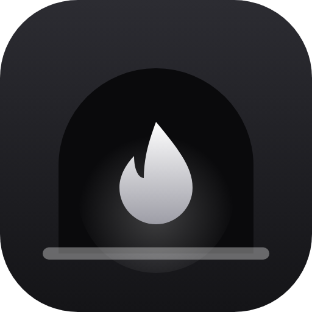</p>

<h1 align="center">Covil</h1>

<p align="center">
  <b>Our own Discord, for our group of friends.</b><br>
  Servers, text channels, voice calls, cameras and smooth screen sharing — on our own server, no account on anyone else's service.
</p>

<p align="center">
  
  
  
  
</p>

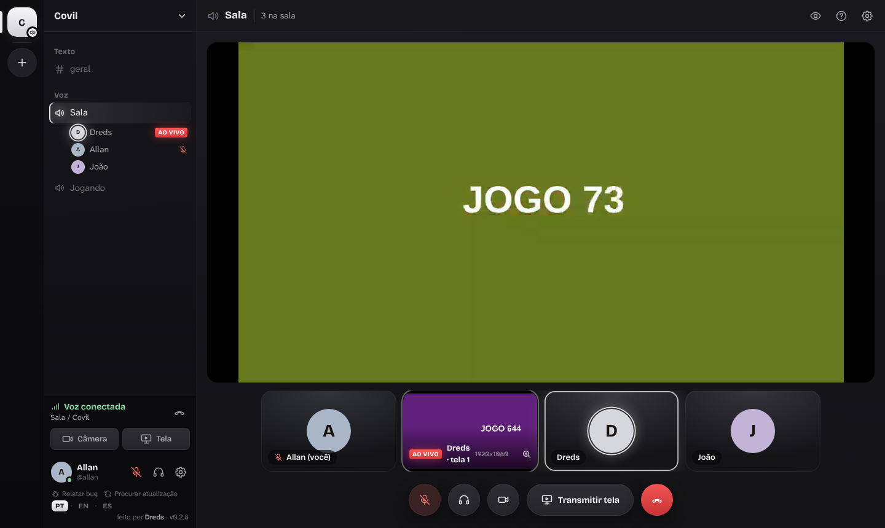

## Why

Discord's screen sharing was the main pain for our group: blurry, cropped ultrawide screens, low frame rates. Covil was built from scratch for a small group of friends. It runs on our own server, which is always on, and everyone joins from the Windows app or straight from the browser.

**This repository is the Covil app for Windows.** The app already knows the server: open it, log in (or create your account with an invite) and you're in. The server itself is private.

## Features

- **Calls that get through** — if a friend's network blocks the call's UDP traffic, Covil falls back to a relay (the LiveKit TURN server) through the same HTTPS port as the site, so anyone who can open the site can join the call. If the server restarts or updates, everyone rejoins their call by themselves within seconds.
- **Talk like on Discord** — push-to-talk and shortcuts for mute, deafen, screen, camera and soundboard sounds (in the Windows app they work even with a game in front), status (Online, Away, Do Not Disturb, Invisible) with a custom line, mute a channel, server or conversation for a while, message search with filters and pinned messages, link previews, polls and voice messages.
- **Server expressions and moderation** — custom emoji (in chat and reactions), a soundboard for voice rooms, timeouts, bans and an audit log.
- **Direct messages and friends** — add friends by @username (even with no server in common), one-on-one chats and groups of up to 10 with files, reactions and replies, and **voice, video and screen calls inside a conversation** that ring the others with Answer / Decline. Block people and choose who can message you (friends and server members, or friends only).
- **Make it yours** — 7 themes that recolor the whole app, an accent color (or your profile color), interface size and compact messages. Click anyone to open their profile card with an "About me", their roles and quick actions.
- **Servers and channels** — text channels with real-time chat, mentions, replies, edits, reactions, images and files up to 1 GB; voice rooms; categories that collapse with one click.
- **Roles and permissions** — roles with a name, color and 12 simple permissions (send messages, files, speak, camera and screen, invites, manage messages, moderate calls, kick, manage channels, roles and server, administrator). Roles shown separately in the member list, and a hierarchy: you only manage people and roles below yours.
- **Rules per channel** — who sees it, who writes (or speaks), who streams, slow mode and a user limit for voice rooms. Private categories hide every channel inside them. An **AFK room** with a configurable timeout (1 min to 1 h) moves people who stay silent, like Discord.
- **Server rules** — written rules everyone can read, optionally accepted before taking part. Call moderation: mute for everyone and remove from the call. Give or remove roles straight from a person's profile card.
- **Screen sharing that looks right** — up to 1440p 60 fps (or source resolution), ultrawide screens stay whole, **up to 4 screens at once**, switch window without dropping viewers, change quality live, sound from the PC. In the Windows app you can pick several screens or "All screens". Click a screen you're sharing to turn its sound on or off, change its quality and "Game / Text" priority on its own, switch the window or stop just that one — viewers get the change within seconds, no reload. Viewers get the full layer (not a downscaled one for small tiles), the tile shows the resolution actually arriving, and right-click mutes a stream just for you. **Small tiles save bandwidth like on Discord**: a screen you see small (side by side, bottom strip) gets a 720p layer, the streamer stops sending the full layer nobody is watching large, and screens pause while Covil is minimized; enlarge one or go full screen and it switches to full quality (up to 2K). It can be turned off in Settings. **Your chosen frame rate is kept**: if your PC or connection can't keep up, the picture gets lighter and you get a notice instead of a stutter. The **Automatic encoder** uses your graphics card (H.264 or H.265) when it can, and the LIVE panel shows whether encoding runs on the GPU or the CPU.
- **Watching streams like on Discord** — hover anyone who's LIVE in the channel list to see a preview of their screen with a Watch button (it joins the call for you), watch **several screens side by side**, and hide your own preview to save resources.
- **Make your profile yours** — an image banner on your card, a nameplate behind your name in the member list, avatar frames (all original Covil art), server tags next to your name (a 3D badge with the icon on a coin), gradient role colors with an animated shine, and "Playing now" in the Windows app (detects the game you have open; you can turn it off or add games).
- **Always up to date** — the app checks for new versions by itself and updates in one click. When a release needs it, anyone on an older app is asked to update before joining a call. Browsers always get the server's version.
- **Organize like on Discord** — server folders (drag one server onto another), a voice channel status line under the channel, and your ping in ms when you hover the call signal.
- **Voice** — instant speaking indicator, per-person volume up to 200%, global shortcuts that work in-game (Ctrl+Shift+M / Ctrl+Shift+D by default, push-to-talk and more in Settings → Shortcuts), three noise-suppression modes including a strong neural one (DeepFilterNet3, with RNNoise as a lighter fallback) running on your own PC that removes construction noise, hammering, keyboard and fans, and "Record 5 s and listen" to hear exactly what others hear.
- **Diagnostics** — one tab that says whether the connection, the call and the audio are fine, and what to do when they aren't.
- **Phone friendly** — the web client has its own phone layout for calls, with a button to flip between the front and back camera.
- **Sounds that mean something** — rising when something starts or someone arrives, falling when it stops or someone leaves; ringing for incoming calls. Preview each one, turn any of them off and set the volume in Settings → Notifications.
- **Three languages** — Portuguese, English and Spanish, picked from your system and switchable at any time (PT · EN · ES). A short tutorial shows up the first time, and "What's new" after each update.
- **Invite-only** — new accounts are created only with an invite: open the link, or paste it in the app under **Create account**.
- **At home with the server** — on the same network as the server, the app finds it by itself and connects directly.

| | |
|---|---|
| 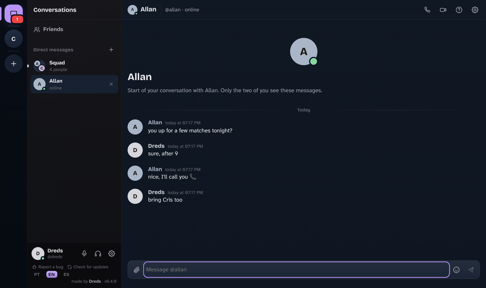 | 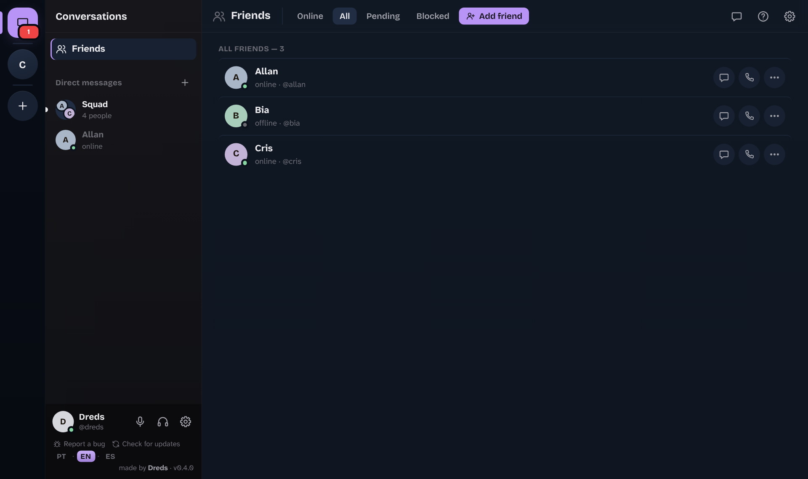 |
| 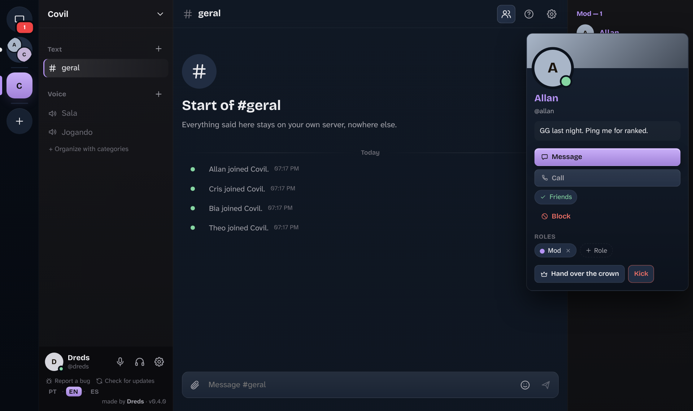 | 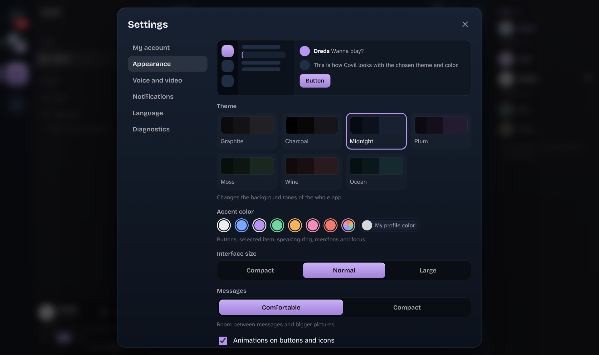 |
| 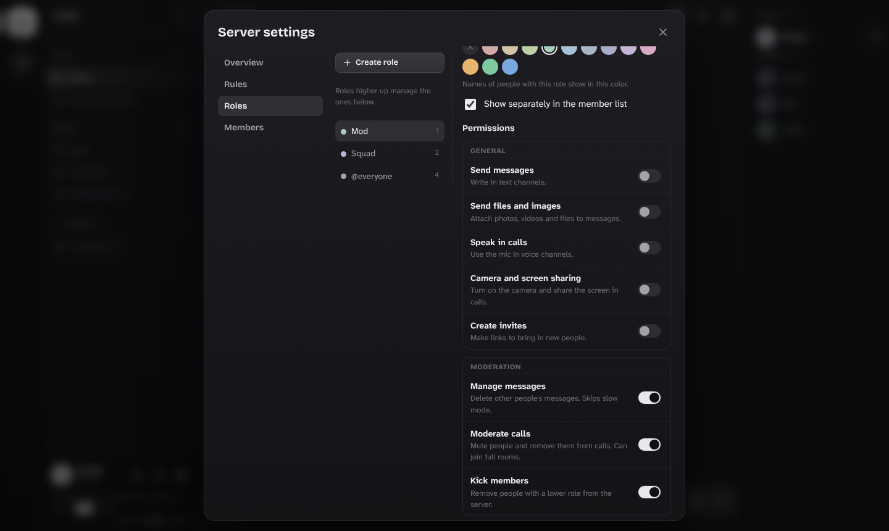 | 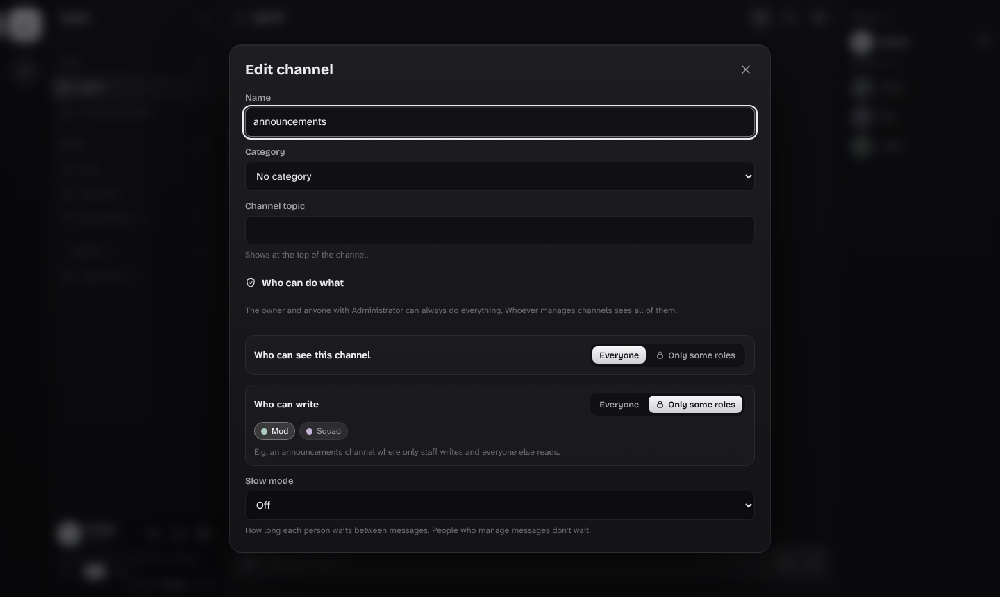 |
| 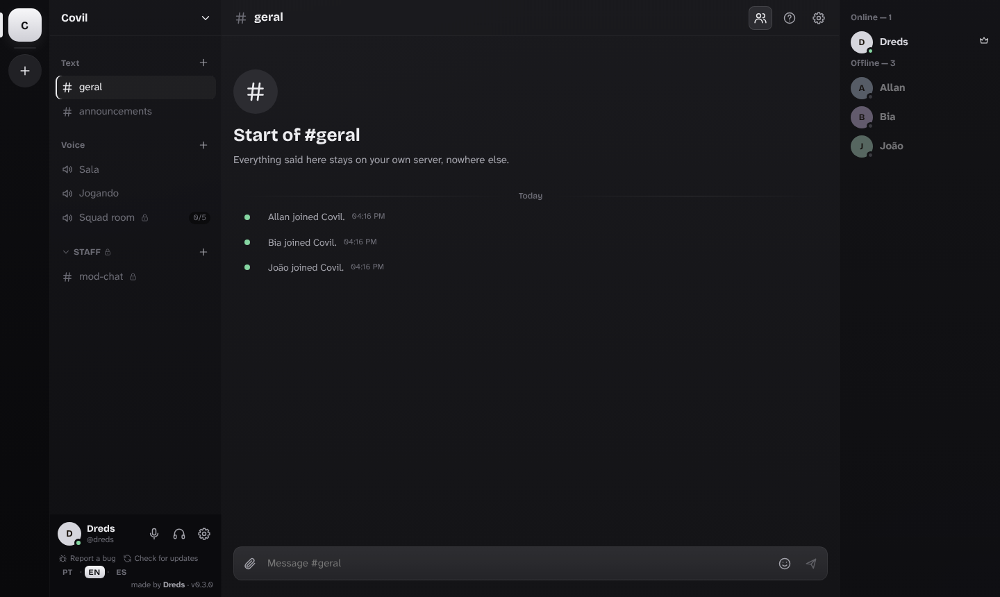 | 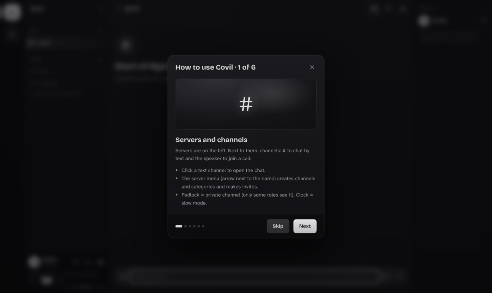 |
| 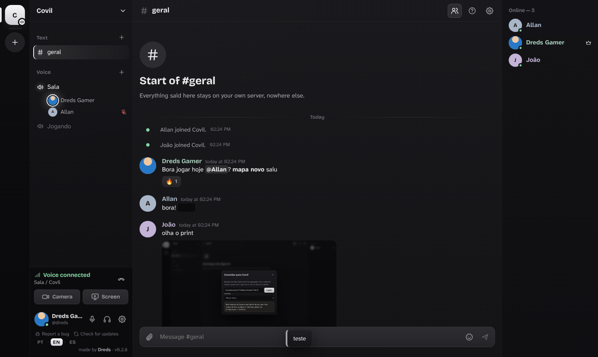 | 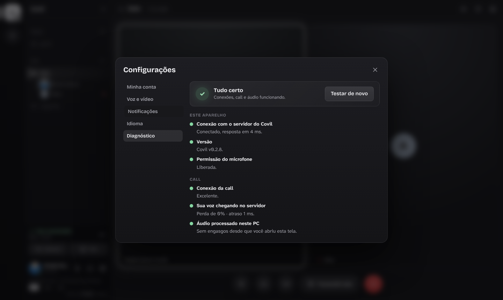 |
| 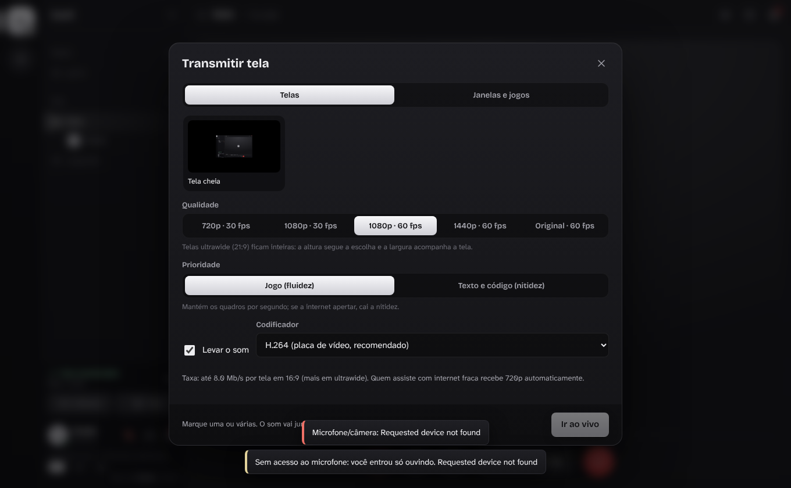 | 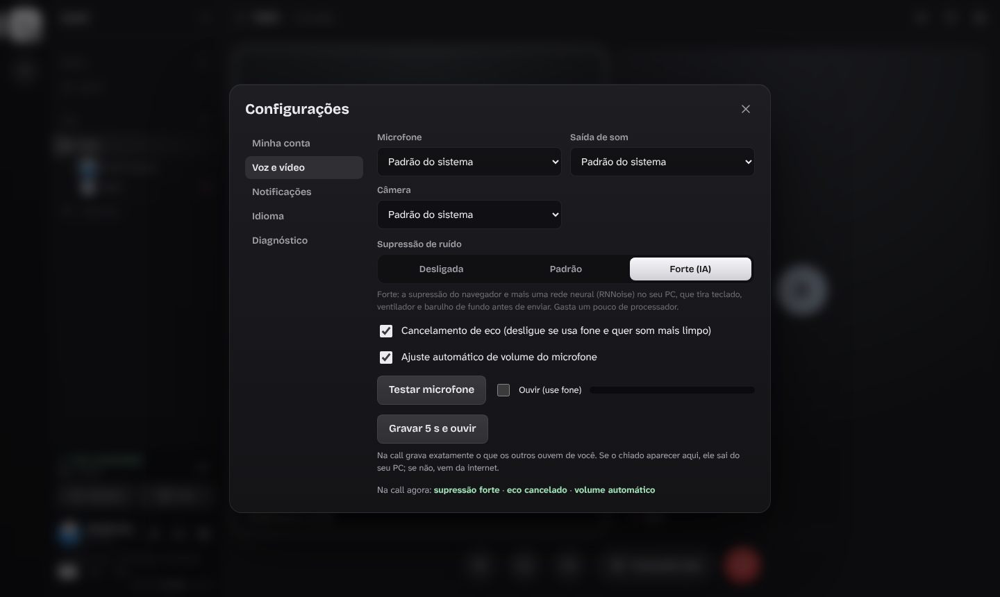 |

<p align="center">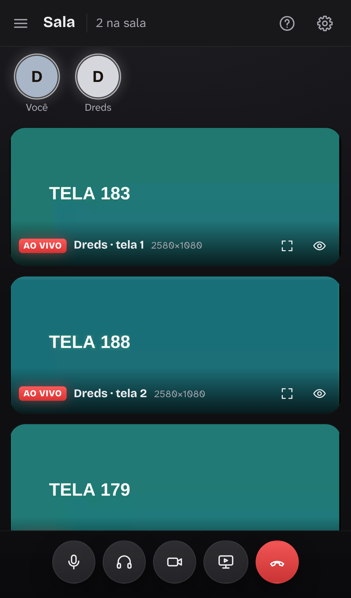</p>

## Install

Covil installs and works the same on **Windows 10 and 11**. You don't need admin rights.

1. Download **`Covil-Setup-X.Y.Z.exe`** from the [latest release](https://github.com/DredsGG/covil/releases/latest) and run it.
   - It installs for your user in `%LOCALAPPDATA%\Programs\Covil`, adds Covil to the Start menu and, if you tick the box, a desktop shortcut.
   - The installer follows your Windows language (Portuguese, English or Spanish).
2. The installer is not code-signed, so the first time Windows may show **"Windows protected your PC"**: click **More info → Run anyway**.
3. Open Covil. Log in, or click **Got an invite? Create account** and paste the invite link a friend sent you.

**Updating:** Covil checks the releases by itself while it's open (when it opens, every 30 minutes and when you come back to the window, at most once every 10 minutes; **Check for updates** in the footer is just a backup). When a new version is out it shows **New version vX.Y.Z** right away, in the middle of the window, with what changed and an **Update** button (the X only snoozes it for an hour; a release marked URGENT can't be dismissed): it downloads the new `Covil-Setup`, checks its SHA-256 against the one GitHub publishes, closes Covil, installs silently and opens it again on the new version. Nothing from old versions is left behind: the downloaded installer is deleted after the update, and old portable copies are listed for you to delete in one click (Settings → App → Look for old versions).

**Uninstalling:** Settings → Apps → Covil. Your settings in `%APPDATA%\Covil` stay (delete that folder too if you want everything gone).

**Portable alternative:** `Covil-vX.Y.Z-windows.zip` — extract the whole folder anywhere and open `Covil.exe`. Pressing **Update** there installs the Setup version, which updates itself from then on.

**From a browser:** open the invite link. Tested on Chrome-based browsers (Chrome, Edge, Brave, Opera GX); Firefox isn't tested yet. On phones you can chat, join calls, use the front or back camera and watch screens; Android browsers can't share the phone's screen.

## Build from source

Requirements: Node.js 22+.

```bash
npm ci --prefix desktop

# portable Windows build (Electron 45 for win32-x64); COVIL_SERVIDOR is the Covil server address
COVIL_SERVIDOR=https://your-server:8443 node scripts/empacotar.mjs electron-v45.0.0-win32-x64.zip out

# Windows installer from that folder (electron-builder, NSIS; on Linux it needs Wine)
cd instalador && npx electron-builder@26.18.0 --win nsis --x64 --prepackaged ../out/Covil --publish never
```

The [Release workflow](.github/workflows/release.yml) builds the app on GitHub (Electron download checked by SHA-256; the server address comes from a repository secret) and, before attaching anything, tests the installer on a real Windows runner: silent install, shortcuts, the installed app opening, the update path (a setup with a wrong SHA-256 is refused; the right one installs silently and Covil reopens), and an uninstall that leaves nothing behind.

## Project layout

| Path | What it is |
|---|---|
| `desktop/` | Electron app: window, tray, global shortcuts and push-to-talk, screen picker with system audio, "Playing now", finding the server on the home network, self-update through the Setup |
| `instalador/` | Windows installer settings (electron-builder NSIS, per user, fixed AppId) and the desktop-shortcut page |
| `scripts/` | Windows packaging |

## Report a bug

Use **Report a bug** in the app footer — it opens an issue here with the version and a diagnostic without personal data. Or [open an issue](https://github.com/DredsGG/covil/issues/new).

## License

MIT © 2026 André Miller Fleck (Dreds). Third-party components are listed in [THIRD-PARTY-NOTICES.md](THIRD-PARTY-NOTICES.md).

Made by [Dreds](https://github.com/DredsGG).
